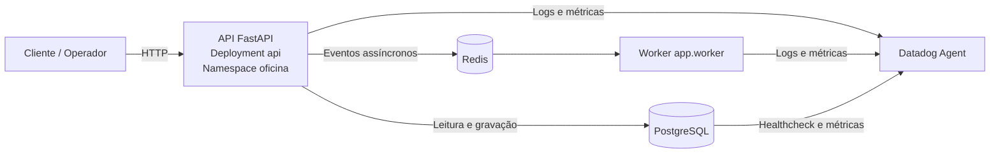

# Oficina Mecânica | Aplicação principal

API REST da solução Oficina Mecânica, construída com FastAPI e executada em Kubernetes.

## Visão geral

| Item | Informação |
| --- | --- |
| Responsabilidade | API, regras de negócio, worker e integrações |
| Runtime | Python 3.12 |
| Entrada principal | Kubernetes Service `api` na porta `8000` |
| Ambientes | `homologacao` e `production` |
| Pipeline | [GitHub Actions](.github/workflows/ci-cd.yml) |
| Estado operacional | Operacional quando o cluster, banco e Redis estão disponíveis |

## Arquitetura geral



## Microsserviços e Repositórios Independentes

A aplicação foi refatorada em três microsserviços totalmente desacoplados, cada um com seu próprio repositório no GitHub, infraestrutura Terraform, banco PostgreSQL isolado, manifests Kubernetes e pipeline de CI/CD:

- **[PosTechFiap_Mecanica_os-service](https://github.com/jptureta/PosTechFiap_Mecanica_os-service)**: Abertura de ordens de serviço, atualização de status, consulta de histórico, tabela de Outbox para auditoria transacional e coordenação da Saga distribuída com compensação idempotente.
- **[PosTechFiap_Mecanica_billing-service](https://github.com/jptureta/PosTechFiap_Mecanica_billing-service)**: Geração e envio de orçamentos para aprovação (notificação por email/webhook), registro e verificação de pagamentos via webhook de provedor externo com token e gestão de estorno (`REFUND_REQUIRED`).
- **[PosTechFiap_Mecanica_inventory-service](https://github.com/jptureta/PosTechFiap_Mecanica_inventory-service)**: Catálogo de peças/serviços, controle concorrente de estoque com locks pessimistas (`SELECT ... FOR UPDATE`), reserva e liberação atômica de peças.
- **Execução e Produção** (`services/execution-service`): fila das ordens aprovadas, acompanhamento de diagnóstico, reparo, cancelamento e conclusão. Usa PostgreSQL para persistência própria e Redis como fila NoSQL; ao concluir, comunica o status final ao OS Service por serviço interno autenticado.

---

## Implementação da Saga Pattern (Orquestração Centralizada e Compensação)

Para coordenar as transações distribuídas entre os microsserviços desacoplados com consistência eventual garantida, foi implementado o **Saga Pattern** com **Orquestrador Central** sediado no `os-service`, suportado pelo padrão **Transactional Outbox** e mensageria assíncrona durável via **RabbitMQ** (com tópicos dedicados e Dead-Letter Queues - `.dlq`).

### 1. Fluxo Transacional Coordenado
1. **Abertura da OS (`POST /orders`)**: O cliente solicita abertura de OS. O `os-service` valida itens de catálogo via HTTP síncrono com o `inventory-service`, persiste a OS em PostgreSQL com estado inicial de Saga `QUOTE_PENDING` e insere o comando `CreateQuote` na tabela `outbox_messages` dentro da mesma transação ACID local.
2. **Relay e Geração de Orçamento**: O relay publica `CreateQuote` na fila durável `oficina.billing.commands`. O `billing-service` consome o comando, calcula os totais, cria o orçamento e publica o evento `QuoteCreated` na fila `oficina.os.events`. O `os-service` transiciona o estado para `QUOTE_CREATED`.
3. **Aprovação do Cliente**: O cliente aprova o orçamento (`POST /quotes/{id}/approval`). O `billing-service` emite `QuoteApproved`, e o `os-service` avança o estado da OS para `AWAITING_PAYMENT`.
4. **Confirmação do Pagamento**: O webhook do provedor externo (Mercado Pago) notifica o `billing-service` (`POST /payments/{id}/verify`), que emite `PaymentConfirmed`. O `os-service` transiciona o estado para `STOCK_RESERVING` e registra o comando `ReserveStock` na Outbox.
5. **Reserva Atômica de Estoque**: O `inventory-service` consome `ReserveStock` de `oficina.inventory.commands`, executa a reserva concorrente via `SELECT ... FOR UPDATE` e emite `StockReserved` em `oficina.os.events`.
6. **Envio para Execução**: O `os-service` consome `StockReserved`, avança o status da OS para `READY_FOR_SERVICE` (Saga `COMPLETED`) e enfileira a ordem automaticamente na esteira de produção/oficina (`ensure_execution_queued` com status `QUEUED`).
7. **Esteira de Produção e Entrega**: A OS progride pela esteira de oficina (`QUEUED -> DIAGNOSING -> REPAIRING -> COMPLETED -> DELIVERED`), com persistência de laudos e diagnósticos técnicos OBD-II no **Amazon DynamoDB**.

### 2. Rollback e Ações de Compensação em Caso de Falha
Em caso de falha em qualquer etapa da transação distribuída, o orquestrador aciona compensações determinísticas e idempotentes:
- **Orçamento Rejeitado (`QuoteRejected`)**: O cliente rejeita a proposta; a OS é cancelada imediatamente (`CANCELLED`).
- **Pagamento Falhou ou Recusado (`PaymentFailed`)**: A OS é transicionada diretamente para `CANCELLED`, sem retenção de recursos.
- **Falha de Reserva de Estoque (`StockReservationFailed`)**: Se o saldo de peças for insuficiente após a confirmação do pagamento, a transação local do inventário falha e emite `StockReservationFailed`. O `os-service` altera seu estado para `COMPENSATION_PENDING` e emite o comando de compensação `RefundPayment` para `oficina.billing.commands`. O `billing-service` marca o pagamento como `REFUND_REQUIRED` (para estorno seguro junto ao provedor) e emite `PaymentRefundRequested`, fazendo com que a OS conclua a compensação em `COMPENSATED` e status final `CANCELLED`.
- **Cancelamento Durante a Oficina / Reparo**: Caso ocorra cancelamento com peças já alocadas e pagamento liquidado, o orquestrador dispara compensação em cadeia ordenada:
  1. Emite comando `ReleaseStock` para devolução atômica das peças ao estoque.
  2. Ao receber o evento `StockReleased`, emite comando `RefundPayment` ao faturamento.
  3. Ao receber `PaymentRefundRequested`, finaliza com estado `COMPENSATED` e status `CANCELLED`.
- **Retentativa Administrativa Idempotente**: Endpoint `POST /orders/{id}/retry-compensation` permite retentar compensações pendentes de forma segura, evitando duplicação de saldo ou reembolsos duplicados.

### 3. Justificativa da Escolha por Orquestração (vs. Coreografia)
A escolha do padrão **Saga por Orquestração** com o `os-service` como orquestrador central foi definida pelos seguintes pilares de arquitetura:
1. **Visibilidade e Auditoria Centralizada**: A Ordem de Serviço é a entidade central e o agregador do negócio da oficina. Manter o estado da Saga (`saga_state`) e a máquina de transições centralizados no `os-service` oferece rastreabilidade ponta a ponta sem espalhar regras de fluxo por múltiplos serviços.
2. **Controle de Compensação Determinístico**: Transações que envolvem dinheiro (reembolsos) e estoque físico exigem ordem estrita de reversão (ex.: liberar peças antes de solicitar estorno). O orquestrador central coordena essa sequência de compensações sem gerar condições de corrida.
3. **Prevenção de Acoplamento Cíclico**: No modelo coreografado, o serviço de faturamento precisaria escutar eventos do inventário e vice-versa, gerando acoplamento complexo. Na orquestração, `billing-service` e `inventory-service` conhecem apenas seus próprios comandos/eventos, desacoplados entre si.
4. **Resiliência e Tolerância a Falhas**: A combinação de *Transactional Outbox*, RabbitMQ durável e Dead-Letter Queues (`.dlq`) garante que nenhum comando se perca em caso de reinicialização ou falha temporária de rede.

### 4. Matriz de Estados da Saga e Compensações

| Etapa | Comando Emitido (Outbox -> RabbitMQ) | Evento Consumido (`oficina.os.events`) | Estado da OS / Saga | Compensação / Rollback em Caso de Falha |
|---|---|---|---|---|
| **1. Abertura** | `CreateQuote` | `QuoteCreated` | `QUOTE_PENDING` -> `QUOTE_CREATED` | Retentativa via Outbox / `/retry-quote` |
| **2. Aprovação** | — | `QuoteApproved` / `QuoteRejected` | `AWAITING_PAYMENT` / `CANCELLED` | `QuoteRejected` cancela a OS imediatamente |
| **3. Pagamento** | — | `PaymentConfirmed` / `PaymentFailed` | `STOCK_RESERVING` / `CANCELLED` | `PaymentFailed` cancela a OS imediatamente |
| **4. Estoque** | `ReserveStock` | `StockReserved` / `StockReservationFailed` | `READY_FOR_SERVICE` (`COMPLETED`) | Em falha: `COMPENSATION_PENDING` -> emite `RefundPayment` (`REFUND_REQUIRED`) -> `COMPENSATED` (`CANCELLED`) |
| **5. Execução** | Fila interna (`/executions`) | Transições `QUEUED -> DIAGNOSING -> REPAIRING -> COMPLETED` | `IN_DIAGNOSIS -> IN_PROGRESS -> COMPLETED -> DELIVERED` | Cancelamento na oficina: emite `ReleaseStock` + `RefundPayment` -> `COMPENSATED` (`CANCELLED`) |

---

Para executar localmente todos os serviços em conjunto com o monólito legado (Strangler Fig pattern):
`docker compose -f docker-compose.yml -f docker-compose.microservices.yml up --build`.
Esse compose usa os repositórios OS, Billing e Inventory presentes ao lado deste repositório no workspace. As rotas `/api/v2` encaminham OS, orçamento/pagamento e catálogo para os serviços nas portas 8001, 8002 e 8003. A OS coordena a Saga com outbox transacional e RabbitMQ; consultas de catálogo necessárias permanecem REST síncronas. Cada serviço acessa exclusivamente seu próprio PostgreSQL, sem acesso direto aos bancos dos demais.

Os novos endpoints aceitam os mesmos JWTs da Lambda (`JWT_SECRET_KEY` e
`JWT_ALGORITHM`). Cadastre peças/serviços pela API v2 usando token de
administrador antes de abrir OS. As rotas `/api/v1` existentes permanecem ativas
durante a migração.

Exemplo do fluxo (substitua os tokens e IDs por valores válidos):

```http
PUT /api/v2/parts/oil-filter
Authorization: Bearer <admin-jwt>
Content-Type: application/json

{"name":"Filtro de óleo","unit_price":"45.90","available_stock":10}

POST /api/v2/orders
Authorization: Bearer <customer-jwt>
Content-Type: application/json

{"customer_id":"<cliente_id-do-jwt>","vehicle_id":"<veiculo_id>","items":[{"kind":"PART","sku":"oil-filter","quantity":1}]}
```

A resposta da OS traz `quote_id`; use esse ID em
`POST /api/v2/quotes/{quote_id}/approval` e
`POST /api/v2/quotes/{quote_id}/payments`. A verificação final é chamada pelo
provedor em `POST /api/v2/payments/{payment_id}/verify` com `X-Provider-Token`.

**Transição:** a API FastAPI e os bancos atualmente implantados permanecem como
legado e ainda não encaminham as rotas existentes para esses serviços. Não
remova os recursos legados nem troque clientes de produção até migrar dados,
configurar os novos secrets, criar/publicar os repositórios remotos e validar
integração/autenticação no gateway.

## Stack e componentes

- Python 3.12, FastAPI e SQLAlchemy
- PostgreSQL e Redis
- Docker e Kubernetes
- Alembic para migrações
- GitHub Actions para testes, imagem e deploy
- Datadog para logs, métricas e alertas

## Status operacional e endpoints (Swagger / OpenAPI)

| Verificação / Documentação | Caminho / URL | Descrição |
| --- | --- | --- |
| **Swagger UI (Interativo)** | [`/docs`](http://localhost:8000/docs) | Interface interativa OpenAPI para teste dos endpoints |
| **ReDoc** | [`/redoc`](http://localhost:8000/redoc) | Documentação técnica alternativa em formato ReDoc |
| **OpenAPI Schema (JSON)** | [`/openapi.json`](http://localhost:8000/openapi.json) | Especificação OpenAPI 3.0 para importação no Postman/Insomnia |
| **Healthcheck** | [`/health`](http://localhost:8000/health) | Verificação de disponibilidade e uptime da aplicação |
| **Métricas** | [`/metrics`](http://localhost:8000/metrics) | Snapshot de requisições, latências P95 e status |
| **Imagem de Container** | `ghcr.io/jptureta/postechfiap_mecanica:latest` | Imagem Docker oficial publicada via CI/CD |

*Nota: Em ambiente local ou via port-forward, acesse em `http://localhost:8000/docs` (ou porta `30000` via NodePort). Em produção na AWS, acesse através da URL base do API Gateway / Load Balancer.*

## Deploy e acesso

### Deploy automatizado

O deploy é executado pelo [pipeline de CI/CD](.github/workflows/ci-cd.yml):

- branch `main`: branch principal protegida; recebe Pull Requests de features e passa pelos checks obrigatórios (não faz deploy sozinha);
- branch `homologacao`: deploy automático de homologação;
- branch `production`: deploy automático de produção;
- imagem publicada no GHCR antes da aplicação dos manifests.

### Acesso local ou via NodePort

O Service Kubernetes é `NodePort` na porta `30000`:

- API: http://localhost:30000
- Swagger: http://localhost:30000/docs
- Health: http://localhost:30000/health

Em cluster remoto, substitua `localhost` pelo IP do node ou endereço do LoadBalancer/Ingress.

### Acesso via port-forward

```bash
kubectl get pods -n oficina
kubectl get svc -n oficina
kubectl port-forward svc/api 8000:8000 -n oficina
```

Com o encaminhamento ativo:

- Swagger: http://localhost:8000/docs
- Health: http://localhost:8000/health

## Execução local

```bash
cp .env.example .env
uv sync --dev
uv run pytest
uv run uvicorn app.main:app --reload --port 8000
```

Alternativamente, use o ambiente definido em `docker-compose.yml`.

## CI/CD e configuração

O pipeline instala dependências, executa testes, constrói e publica a imagem Docker e aplica os manifests Kubernetes. Os secrets esperados incluem `KUBE_CONFIG`, `DB_PASSWORD` e `JWT_SECRET_KEY`; as demais configurações devem seguir `.env.example` e os manifests em `k8s/`.

## Observabilidade

- logs estruturados em JSON com `X-Request-ID`;
- métricas HTTP e de negócio em `app/observability.py`;
- endpoint `/metrics` para diagnóstico;
- probes de liveness, readiness e startup;
- manifesto do Datadog Agent em `k8s/datadog-agent.yaml`;
- dashboard de exemplo em `datadog-dashboard-example.yaml`;
- definição declarativa de alertas e monitores em `datadog-monitors.yaml`.

## Estrutura do repositório

```text
app/                 Código da API, domínio e worker
alembic/             Migrações do banco
k8s/                 Deployments, Services, probes e Datadog
tests/               Testes automatizados
services/            Serviço de execução local e snapshots legados dos microsserviços
docker-compose.microservices.yml
Dockerfile           Imagem da aplicação
.github/workflows/   Pipeline de CI/CD
```

## Segurança e governança

- `main` protegida; deploys automáticos partem das branches `homologacao` e `production`, ambas também protegidas contra push direto;
- secrets não devem ser versionados;
- containers executam sem privilégios elevados;
- merge somente via Pull Request com checks obrigatórios.
